# HIUSA process flow

How work moves through HIUSA, from the Student Affairs Office (SAO) down to a student, written from the built system (branch `hf/release2`, 2026-11-08). Every screen name and button label below is the text the code shows; every rule named under "The system enforces" is in the controller or middleware cited next to it. Paths are relative to `server/app/` for PHP and `client/src/` for React.

The dean asked to "always see the flow so I can say I am here now". Each home page therefore opens with the process tracker (section 2), which shows the steps of the process the signed-in person is in.

## 1. The hierarchy

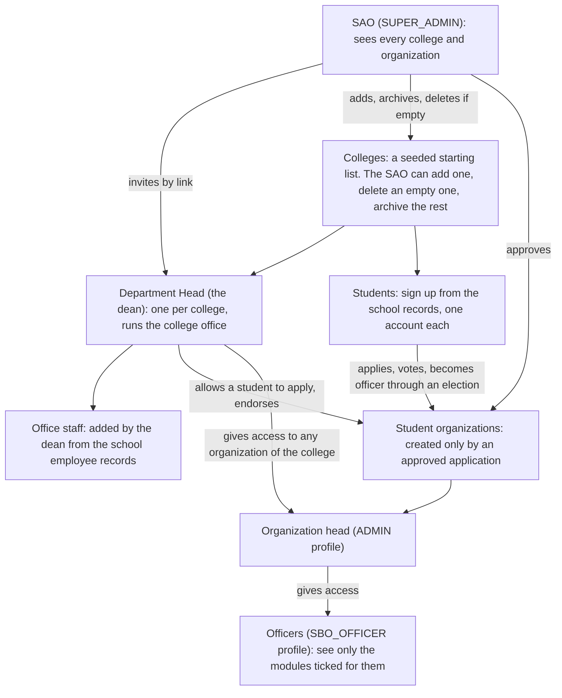

Who can act on whom, in the code:

| Level | Reaches | Enforced by |
|---|---|---|
| SAO | Every college and organization | `role:SUPER_ADMIN` on the `/system/*` routes in `routes/api.php` |
| Department Head | The organizations of the one college of the account | `User::scopedOrganizationIds()` in `Models/User.php`, which widens only for a COLLEGE home organization |
| Organization head and officers | Their own organization | Every query is filtered by the active profile's `organization_id` (`Http/Middleware/UseAccountProfile.php`) |
| Officer modules | The modules ticked on the profile | `Http/Middleware/EnsureOrganizationModule.php` (`org.module`) |
| Student | Own records, events, votes and orders | `role:STUDENT` routes and per-record checks |

The demo accounts and passwords are not in this file. See `docs/DEMO_SCRIPT.md` for the logins by email.

## 2. Where am I: the process tracker

`GET /process/status` (`Http/Controllers/ProcessStatusController.php`, `Services/Dashboard/ProcessStatusService.php`) returns the steps for the role. The first step not done is the current one and carries one action button. When every step is done the tracker is replaced by one line, "Setup complete". The tracker is the component `components/process/ProcessTracker.jsx`, mounted on the Dashboard of the SAO, the Department Head, the Organization Admin and the student (the student sees it only with a grant or an application).

| Role | Steps, in order |
|---|---|
| SAO, one row per college | Dean invited, Dean active, School records loaded, Organizations applying, Organizations active |
| Department Head | Office staff added, Student records loaded, Students allowed to apply, Applications reviewed, Organizations active |
| Organization Admin | Organization approved, Officers given access, Semester requirements submitted, Renewal (only when a renewal is due), Election of next officers |
| Student with a grant or an application | Allowed to apply, Application sent, Dean review, SAO review, Approved |

Counts on each step are real queries scoped like the rest of the system (a dean sees only the own college).

## 3. Study objectives used in this file

Quoted from Chapter I of `docs/(4) HIUSA - FINAL.md`, "Objectives of the Study".

- **General Objective (GO):** analyze, design, develop, test and evaluate a student body organization management system that uses AI-integrated digital functionalities to help student body organizations at the University of Cebu, Lapu-Lapu and Mandaue improve financial management, event and task coordination, elections, merchandise management and organizational communication "through a centralized and systematic platform".
- **Specific Objective 1 (SO1):** identify and assess current governance and financial management practices (processes, problems encountered).
- **Specific Objective 2 (SO2):** determine the mechanisms for 2.1 financial management, 2.2 event management, 2.3 task management, 2.4 elections, 2.5 merchandise management, 2.6 organizational communication.
- **Specific Objective 3 (SO3):** define and develop the best features of the proposed system.
- **Specific Objective 4 (SO4):** evaluate the level of acceptability of the proposed system.

SO1 and SO4 are assessed outside the application (`docs/PAPER_SCOPE_ADDENDUM.md` section 1), so no process below maps to them. The college hierarchy came after the dean's feedback and is not in the submitted paper; `docs/PAPER_SCOPE_ADDENDUM.md` section 2.4 lists the paper changes it needs. Processes 1 to 6 and 10 therefore serve the GO ("one centralized platform", one login per person) and SO3 (features), and touch SO2 only where the table says so.

| # | Process | Objectives | Closest use-case document |
|---|---|---|---|
| 1 | SAO onboards a dean | GO, SO3 | `manage-colleges-use-case.md`, `manage-user-accounts-use-case.md` |
| 2 | Dean sets up the college office and student records | GO, SO3 | `manage-user-accounts-use-case.md` |
| 3 | Students sign up from the school records | GO, SO3 | `authenticate-recover-account-use-case.md` |
| 4 | Dean allows a student to apply | GO, SO3 | none yet, this file is the description |
| 5 | Organization application and two-step review | GO, SO3, SO2.6 (notices to the applicant and reviewers) | `submit-requests-approval-use-case.md`, `review-decide-approval-requests-use-case.md` |
| 6 | Officers' access and permissions | GO, SO3, and SO2.1 to SO2.6 (the module list follows those six areas) | `manage-user-accounts-use-case.md` |
| 7 | Election of officers hands over access | SO2.4, SO3, GO | `manage-elections-use-case.md`, `view-election-results-use-case.md` |
| 8 | Semester requirements, semestral and financial report, renewal | SO2.1, SO2.6 (reminders), SO3, GO | `view-financial-reports-history-use-case.md` |
| 9 | Advance planning and school-year records | SO2.2, SO2.3, SO2.4, SO2.1 (what the Records page lists), SO3 | `manage-events-scheduling-use-case.md`, `manage-tasks-workflow-use-case.md` |
| 10 | Dean and SAO oversight of an organization | GO, SO2.1, SO2.2, SO3 | `view-financial-reports-history-use-case.md`, `role-based-dashboard-use-case.md` |

## 4. The processes

### Process 1. SAO onboards a dean

Actors: SAO (SUPER_ADMIN), the dean to be.
Trigger: a college has no Department Head ("No Department Head yet" on its card), or the SAO has just added the college.

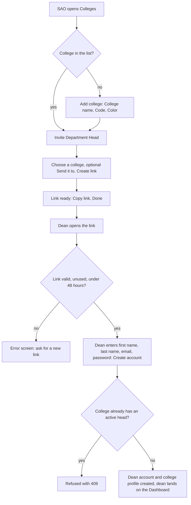

Steps:
1. The SAO signs in and opens **Colleges** (sidebar, group Governance).
2. If the college is new: **Add college** in the page header, fill **College name**, **Code** (optional), **Color** (optional), confirm. The system creates the college and its home organization (type COLLEGE).
3. **Invite Department Head** (page header, or the button on a college card that has no head). In the dialog choose **College**, optionally fill **Send it to** (an email address), then **Create link**.
4. The dialog **Link ready** shows the invitation link with **Copy link** and **Done**. The link works once and expires in 48 hours.
5. The dean opens the link. The screen says "You're invited to lead <College>" and asks for **First name**, **Last name**, **Email**, **Password**, **Confirm password**. **Create account** signs the dean in on the Dashboard. The school ID field is not shown; the system gives the account an internal number.

Outputs: a Department Head account on the college home organization with an account profile; an audit log row for the invitation and for its acceptance; the SAO tracker step "Dean active" turns done.

The system enforces:
- Only the SAO can invite: `role:SUPER_ADMIN` on `POST /system/colleges/{college}/invite-department-head`.
- One pending link per college: `invite()` in `Http/Controllers/DepartmentHeadInvitationController.php` deletes an earlier unaccepted link; it answers 409 when the college already has an active head and 404 for an archived college.
- The link is a 64 character random token stored only as a SHA-256 hash, single use, 48 hours; the account is created inside a transaction that locks the invitation and the college row, so two people cannot both become the dean (same controller, `createAccount()`).
- Adding and deleting colleges: `Http/Controllers/CollegeController.php`. `store()` creates the college and its home organization. `destroy()` answers 409 "This college still has organizations or people. Archive it instead." when the college has student organizations, any account, a live dean or staff link, an application or a school record. Archive and restore are always allowed.
- An archived college blocks sign-in for its people (`UserController::login`).
- Adding SAO staff works the same way and belongs to no college. On **University users** the SAO opens **Add SAO staff**, optionally fills **Email** (it ties the link to that address and is emailed only when mail is on), then **Create link**. The dialog shows the link with **Copy link** and, under **Waiting for a reply**, every unused link with **Copy link** (a new link; the old one stops) and **Revoke**. The person opens the link, which says "You're invited to the Student Affairs Office as SAO staff", types **First name**, **Last name**, **School ID**, **Email** and **Password**, and lands on the SAO dashboard as a SUPER_ADMIN account with a profile in the SAO organization. Only the SAO can make, list, renew or revoke these links (`role:SUPER_ADMIN`, `/system/sao-staff/invitations`); both the invitation and its acceptance are audited.

### Process 2. Dean sets up the college office and student records

Actors: Department Head, office staff to be, SAO (can load records for any college).
Trigger: a new dean signs in and the tracker shows "Add office staff" and "Load student records".

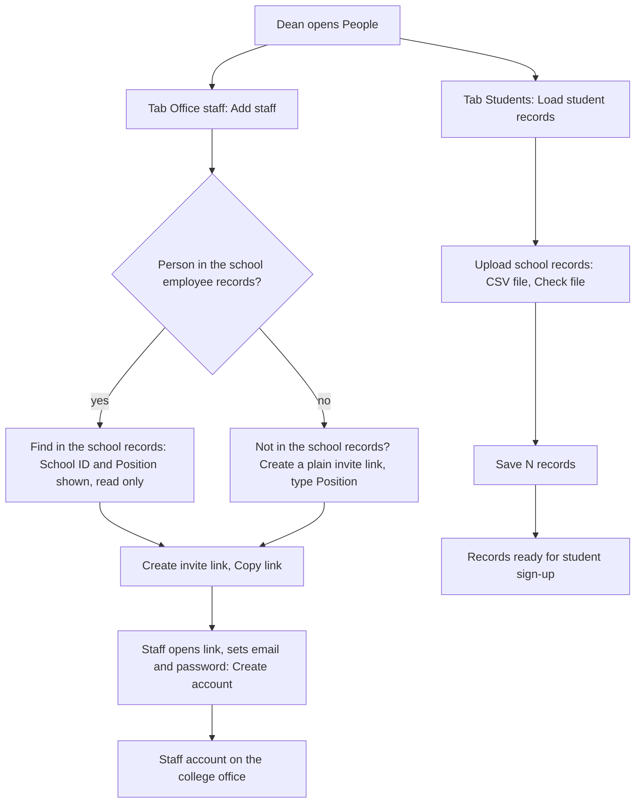

Steps, office staff:
1. The dean opens **People** (sidebar) and the tab **Office staff**, then **Add staff**.
2. In **Add office staff**, type in **Find in the school records**. The list holds only unclaimed employee records of the own college. Choosing one shows **School ID** ("Given by the school. It cannot be changed.") and **Position** read only.
3. **Create invite link**, then **Copy link** and **Close**. If the college has no employee records, or the person is not in them, **Not in the school records? Create a plain invite link** asks for a **Position** and creates a link with no identity.
4. The staff member opens the link. The screen says "You're invited to <College> as office staff". For a school-record link the **Name** and **School ID** are read only and the person sets **Email** and **Password** only; for a plain link the person also types the names. **Create account**.
5. To take someone off the office the dean uses **Remove** in the same tab ("Remove from the college office").

Steps, student records:
1. On the tab **Students** the dean uses **Load student records** (also offered in the empty state). The panel **Upload school records** opens.
2. Choose the **CSV file** (columns school_id, first_name, last_name, birth_date, program, year_level; optional section, record_type, position), then **Check file**. Rows that need fixing are listed and skipped.
3. **Save N records** writes the checked rows. **Choose another file** starts again.
4. The SAO does the same for every college from **Student records** (sidebar, group Governance), where a **Show** filter switches between Students and Employees.

Outputs: staff accounts claimed from employee records (the record is marked claimed); student records waiting for sign-up; tracker steps "Office staff added" and "Student records loaded".

The system enforces:
- Only an unclaimed EMPLOYEE record of the dean's own college can become a link, locked against two links at once, and a client cannot send a name or ID for a record link (`prohibited` rules in `DepartmentHeadInvitationController::accept`, `availableEmployeeRecord()`).
- The dean's upload is forced to the own college and a row for another college is rejected: `Http/Controllers/StudentRegistryController.php` (`actorCollegeId()`, `classify()`); nothing is written unless the file passes the check and the same file is applied (`preview` then `apply`).
- The staff list endpoint `GET /college/staff/records` is `role:DEPARTMENT_HEAD` and scoped by `CollegePeopleController::staffRecords`.
- Passwords are never typed by the dean: every account is created by its owner through a link.

### Process 3. Students sign up from the school records

Actors: student.
Trigger: the student's record is in the school records and no account exists.

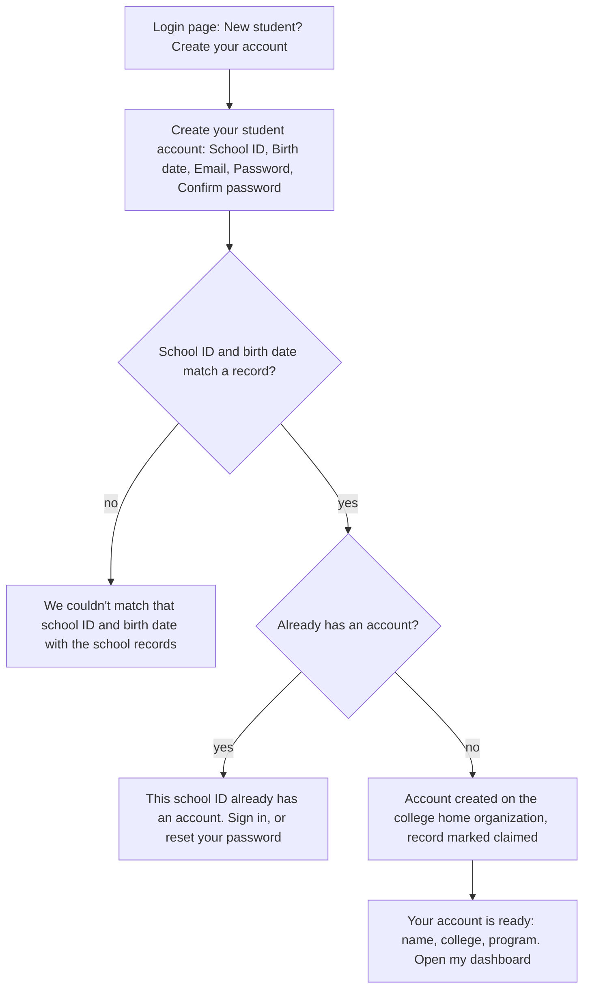

Steps:
1. On **Sign in** the student chooses **Create your account** ("New student?").
2. **Create your student account**: **School ID**, **Birth date**, **Email**, **Password**, **Confirm password**, then **Create account**. The school ID is the one place a person types it.
3. **Your account is ready** shows the name, college, program and year from the record and says "You cannot apply yet. Ask your Department Head to allow you." **Open my dashboard** goes to the student Dashboard.
4. Later sign-ins use **Email or school ID** and **Password**.

Outputs: a STUDENT user and account profile on the college home organization; the school record marked claimed; an audit row `student_signed_up`.

The system enforces (`Services/Edp/StudentSignup.php`, `Http/Controllers/UserController.php`):
- Names, program, year and college come from the record, never from the browser; there is no organization input.
- A wrong ID or birth date gives one answer for both, and five misses on one school ID block it for 15 minutes (429).
- A claimed record or an existing account is refused; the claim and the user insert run in one transaction (`markClaimed`).
- Sign-up fails closed when the college is archived or the registry cannot be reached (503). The registry is behind the interface `Services/Edp/StudentRegistry.php`, so the live EDP can replace the local table.
- The `registration` throttle on `POST /register` and `POST /register/lookup`.
- A student on a college home organization gets no dean scope (`User::scopedOrganizationIds()` returns only the home id for non-heads).

### Process 4. Dean allows a student to apply

Actors: Department Head, student.
Trigger: a student wants to start an organization; the tracker shows "Allow a student to apply".

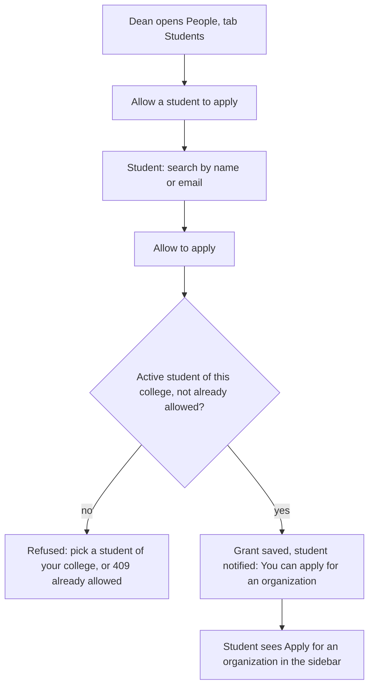

Steps:
1. The dean opens **People**, tab **Students**, and chooses **Allow a student to apply** (the same button is on **Organizations**, and is the one action of its empty state "No organizations yet").
2. In **Allow a student to apply**, search the **Student** by name or email, then **Allow to apply**.
3. The student gets the notification "You can apply for an organization" and the sidebar item **Apply for an organization** appears.
4. A grant the student has not used can be taken back from the grant list; a used grant cannot.

Outputs: one open grant for that student in that college; notification; audit rows `applicant_grant_created` and `applicant_grant_revoked`.

The system enforces (`Http/Controllers/ApplicantGrantController.php`):
- The college always comes from the dean's own account, never from the request; the student must hold an active STUDENT profile in that college.
- The college row is locked while the grant is written, and a second open grant for the same student is a 409.
- Revoking an already used or revoked grant is a 409.
- Only `role:DEPARTMENT_HEAD` reaches `/college/applicant-grants`.

### Process 5. Organization application and two-step review

Actors: the applicant (student), Department Head, SAO.
Trigger: a student with an open grant opens **Apply for an organization**.

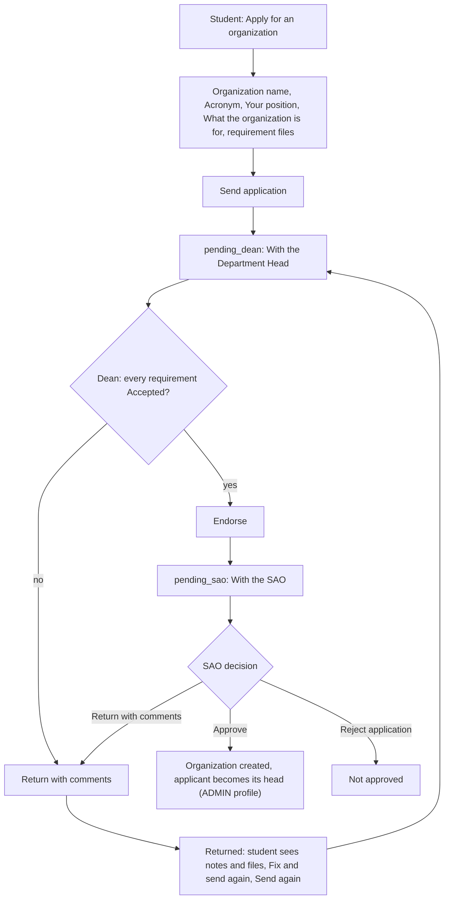

Steps:
1. The student opens **Apply for an organization**. The form asks **Organization name**, **Acronym**, **Your position** ("What you will be called in the organization."), **What the organization is for**, and one file per listed requirement. **Send application**. If the SAO has no open semester with requirements, the page says "Applications are closed"; without a grant it says "You cannot apply yet".
2. The dean opens **Organization applications** (sidebar). The tab **To review (n)** lists applications with the status "With the Department Head". **Review** opens the application, titled with the organization name.
3. For each requirement the dean opens the file, picks **Not checked**, **Accepted** or **Needs changes**, writes **Note for the applicant**, and can **Attach a file to <requirement>**. **Other files for the applicant** and **Comments for the applicant** are for the whole application.
4. **Endorse** turns on when every requirement is **Accepted**. **Return with comments** turns on when there is a note or a requirement marked **Needs changes**. Endorsing moves the application to "With the SAO" and notifies the SAO.
5. The SAO opens **Applications** (sidebar, group Governance), tab **To review**, and reviews the same way. The buttons are **Approve** (needs every requirement **Accepted**), **Return with comments** and **Reject application** (needs a comment).
6. A returned application shows the student, on **Your application**, the per requirement notes, **Files from the reviewers** and the card **Fix and send again** with **Send again**. It goes back to the dean with a new round.
7. On approval the organization appears in the college, and the notification "You are now <position> of <organization>. Switch to it from the account menu." reaches the applicant.

Outputs: an `Organization` of type STUDENT_ORGANIZATION in the grant's college; an ADMIN account profile for the applicant with the chosen position; the submitted documents copied in as approved registration documents; per round reviews and files kept; notifications and audit rows at every step.

The system enforces (`Http/Controllers/OrganizationApplicationController.php`, `OrganizationApplicationReviewController.php`):
- Submitting needs an open grant (403 "Ask your Department Head to allow you to apply.") and the requirement list the SAO set for the semester; if the list changed while the form was open the answer is 409 "The requirements changed. Reload the page."
- Which step a person may act on follows the role: the dean only on `pending_dean` and only for the own college, the SAO only on `pending_sao`; a wrong college and a missing id answer the same, so a dean cannot probe other colleges (`authorizeScope()`). A stale click is a 409 "This application is not waiting for you."
- Endorse and approve need every requirement marked ok and every document still on disk; a return needs a note or a flagged requirement; a rejection needs remarks.
- Approval creates the organization in the college named on the grant (never from the browser), refuses a name or acronym already in use, and adds an ADMIN profile without touching the applicant's own account, role or home organization (`approve()`).
- Review files sit on the private disk and open only through the protected `open_url` routes, scoped like the review.
- The student can only resubmit a returned application (`resubmit()`), and the grant is marked used by the application.

### Process 6. Officers' access and permissions

Actors: Department Head or Organization head (grantors); the student receiving access.
Trigger: a new organization needs officers, or an officer's duties change.

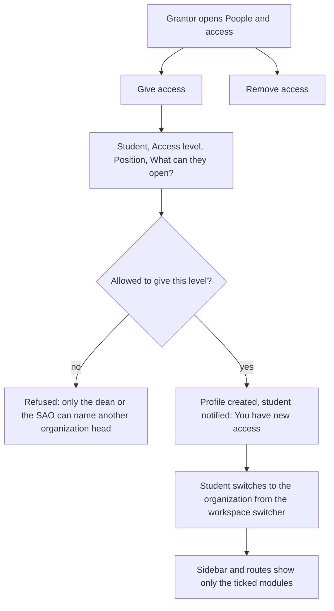

Steps:
1. The organization head opens **People** (sidebar, Members) and finds the card **People and access**. The dean opens **Organizations**, row action **Open organization space**, then the tab **People and access**. Both mount the same panel.
2. **Give access** opens a dialog: **Student** (search by name or email), **Access level** (Organization head, Officer, Member), **Position** (from the organization's **Officer positions** list), and, for an Officer, **What can they open?** with the boxes Members, Events, Finance, Tasks, Merchandise, Elections, Compliance, Announcements (all ticked by default, at least one required).
3. The student is notified "You have new access" and finds the organization in the workspace switcher in the top bar; the sidebar lists only the ticked modules.
4. On each row **Change** opens **Change access** to edit level, position and boxes; **Remove** opens **Remove access**, which takes the profile off that organization only.

Outputs: an `AccountProfile` for the student in the organization, with `modules` empty meaning everything; notification and audit row `organization_membership_added` or `organization_access_changed`.

The system enforces (`Http/Controllers/AccountProfileController.php`, `Services/AccountProfileDeletionService.php`, `Http/Middleware/EnsureOrganizationModule.php`):
- Only an active student account of the college of the organization can be picked (`eligibleUsers()`); someone already in the organization is a 409.
- The position must be on the organization's own position list, and module keys must be in `AccountProfile::MODULES`.
- An organization head cannot name another organization head in the own organization; only the dean or the SAO changes or removes an Admin profile (`assertMayGrant()`, `permissionFailure()`).
- The last active Admin cannot be demoted or removed (422 "Assign another active Admin before changing the last one.").
- An officer with ticked modules gets 403 "You do not have access to this part of the organization." on any other module route; the routes an officer uses as an ordinary member (vote, feed, shop, own tasks) stay open.
- Students and officers cannot grant: the invite route is `role:SUPER_ADMIN,DEPARTMENT_HEAD,ADMIN`.

### Process 7. Election of officers hands over access

Actors: Organization head (builds the election), voters (members), Department Head (approves the election request), the system.
Trigger: the organization wants its next officers; the Admin tracker step "Election of next officers".

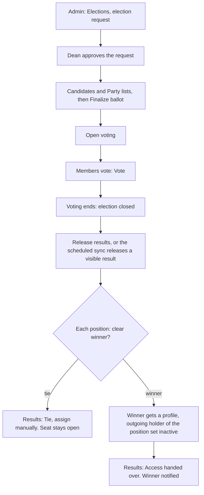

Steps:
1. The Admin opens **Elections** (sidebar, Voting) and sends an **Election request**; the dean approves it under **Approvals**.
2. The Admin adds **Candidates** and **Party lists**, then **Finalize ballot** (it asks for at least one candidate on every position and one party list), then **Open voting** inside the voting window.
3. Members use **Vote**. The election closes when its end time passes.
4. The Admin presses **Release results** (or, for an election whose results are already visible, the scheduled `SyncElectionStatuses` command does the same on its next run).
5. **Results** shows the winners. The badge **Access handed over** says "Winners now have access to the organization in their positions. Officers they replaced no longer do." A tied position shows **Tie, assign manually**; the Admin or dean gives that access by hand from **People and access**.

Outputs: ADMIN profile for a winner of the head or president position, SBO_OFFICER profile for every other position, `position_title` set to the position, all modules; outgoing holders of the same position set inactive; notification "You now have access to <Organization>"; audit row `access_handed_over`; the tracker step turns done.

The system enforces (`Services/ElectionHandoverService.php`, called from `Http/Controllers/ElectionController.php::update` and `Models/Election.php::syncStatuses`):
- It runs only for a closed, finalized election with visible results, and once: `access_handed_over_at` is claimed atomically, so a second release does nothing.
- A tie leaves the seat open and its outgoing holders keep access; only candidates strictly ahead of the tie win.
- Which role a position gets comes from the organization's position list, else from the word "president" in the title (`roleFor()`).
- An organization head the dean named for another position keeps that access when they win a lower seat; only holders of the same position title are retired.
- Ballot rules before voting: approved election, finalized ballot, voting window (`ElectionController::finalize`, `update`); `ElectionController::vote` refuses a second ballot ("You have already voted in this election.") and a ballot that is not complete, and the route is throttled (`throttle:voting`, `role:ADMIN,SBO_OFFICER,STUDENT`).

### Process 8. Semester requirements, semestral and financial report, renewal

Actors: SAO (sets and reviews requirements), Organization head (submits), Department Head (tracks and reminds, approves the financial report first), officers with Finance and Compliance modules (read).
Trigger: the SAO opens a semester, or a renewal or report deadline comes.

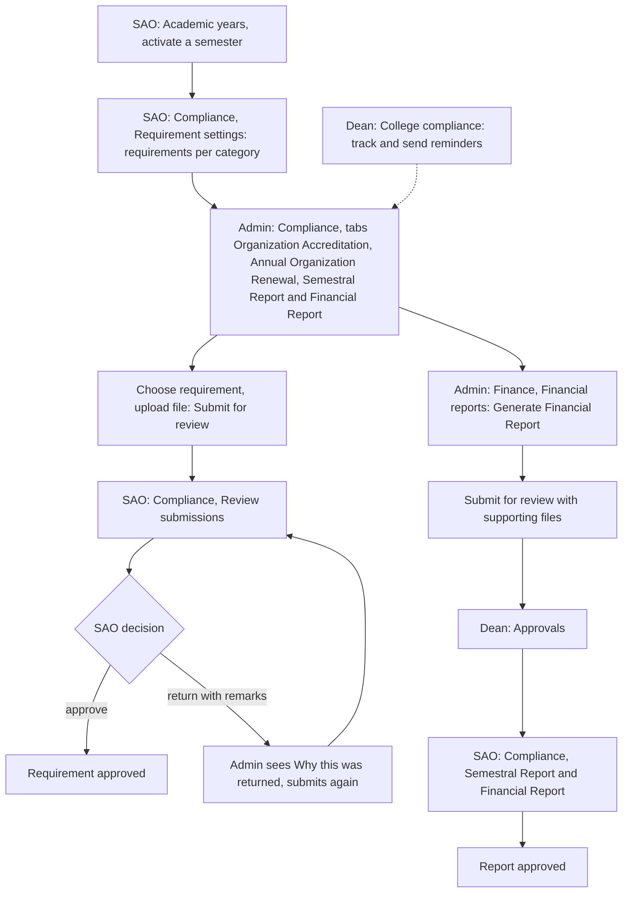

Steps:
1. The SAO opens **Academic years** (sidebar, Setup and records), adds the year and semesters, and activates the semester. Activating closes the previous semester.
2. In **Compliance** (SAO), the tab **Requirement settings** holds the lists **Organization requirements**, **Renewal requirements**, **Event requirements** and **Semestral report & financial report requirements**.
3. The Organization head opens **Compliance** (sidebar, Records). The tabs are **Organization Accreditation**, **Annual Organization Renewal** and **Semestral Report & Financial Report**. For a requirement, upload the file and press **Submit for review**.
4. The SAO opens **Compliance**, tab **Organizations**, then **Review submissions**, and approves a submission or returns it with remarks. A returned requirement shows the Admin "Why this was returned".
5. For the financial report the Admin opens **Financial reports** (sidebar, Finance), uses **Generate Financial Report**, opens the report and presses **Submit for review** (or **Resubmit for review**) with up to 10 supporting files.
6. The report goes first to the dean under **Approvals**, then to the SAO. The SAO sees it in **Compliance**, tab **Semestral Report & Financial Report**. The Renewal tab holds the yearly renewal submissions.
7. The dean opens **College compliance** to see which organizations are behind and to send a reminder.

Outputs: submissions with status submitted, approved or returned and the reviewer's remarks; approved reports; reminders as notifications; tracker steps "Semester requirements submitted" and "Renewal".

The system enforces:
- Only the Organization head submits (`role:ADMIN` on `POST /compliance/submissions`) and only the SAO reviews (`role:SUPER_ADMIN`, `ComplianceController::reviewSubmission`); a return needs remarks.
- The review checks the `submitted_at` the reviewer saw under a row lock, so a resubmission made meanwhile is never approved unseen; archived or unapproved organizations and closed semesters cannot be reviewed.
- Writes are blocked in a closed school year with 409 "This school year is closed. Its records are read only." (`Http/Middleware/EnsurePeriodWritable.php`, route flag `period.writable`).
- A financial report can be submitted only when it is a draft or was rejected, and not after the ledger changed since it was generated (`Http/Controllers/FinancialReportController.php::submit`); the status moves to `pending_department_head`, then `pending_sao` through `ApprovalRequestController`.
- Supporting files sit on the private disk behind a login and go through the upload policy (`Services/SubmissionStoragePolicy.php`).
- A dean can send reminders only to organizations of the own college (`role:SUPER_ADMIN,DEPARTMENT_HEAD` on `ComplianceReminderController`, scoped by `scopedOrganizationIds()`).

### Process 9. Advance planning and school-year records

Actors: SAO, Department Head, Organization head (plan ahead); SAO, dean, Admin and officers (read records).
Trigger: a coming semester needs events, tasks or requirements before it starts, or someone needs to see how a past year ended.

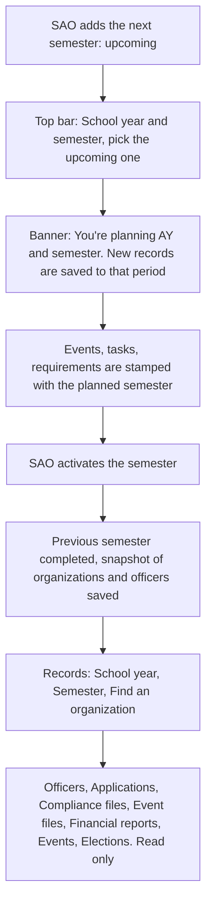

Steps:
1. The SAO adds the next semester in **Academic years**. It stays upcoming.
2. Dean, Admin and SAO open the semester picker in the top bar (**School year and semester**) and choose the upcoming semester ("Upcoming, for planning"). The banner says "You're planning <AY> <Semester>. New events, tasks and requirements you add are saved to that period."
3. Events, tasks, elections and requirements created now belong to the planned semester. Officers can read a period but not select an upcoming one.
4. When the SAO activates the semester the previous one is completed and a snapshot of every student organization (status and officers at that time) is saved.
5. **Records** (sidebar) lets the SAO, a dean, an Admin or an officer pick **School year** and **Semester**, **Find an organization**, and read **Officers**, **Applications**, **Compliance files**, **Event files**, **Financial reports**, **Events** and **Elections**. A closed period carries the badge **Read only**. Files open through protected links. The picker also has **Open records** when closed semesters exist.

Outputs: planned records stamped to the right semester; `organization_semester_records` snapshots; a read only archive per school year.

The system enforces:
- The selected period comes from the `X-Academic-Semester` header, honored only for SUPER_ADMIN, DEPARTMENT_HEAD, ADMIN and SBO_OFFICER, and an upcoming period only for the first three (`Models/AcademicSemester.php::selected`); a new record goes to the selected period unless it is closed (`forNewRecord`).
- A write in a closed period, or an edit of a row that belongs to a closed semester, answers 409 (`EnsurePeriodWritable`). Rows of a semester that has not started stay editable.
- Snapshots are written on activation and on closing (`Http/Controllers/AcademicSemesterController.php`, `Services/Records/SemesterSnapshotService.php`).
- `GET /records` is scoped by role: SAO all, dean the organizations of the college, Admin and officer the own organization, with 403 "You cannot open records for that organization." for anything else (`Http/Controllers/RecordsController.php`).

### Process 10. Dean and SAO oversight of an organization

Actors: Department Head (own college), SAO (any student organization). Organization members never see this view.
Trigger: the dean or SAO wants everything about one organization, including its transactions.

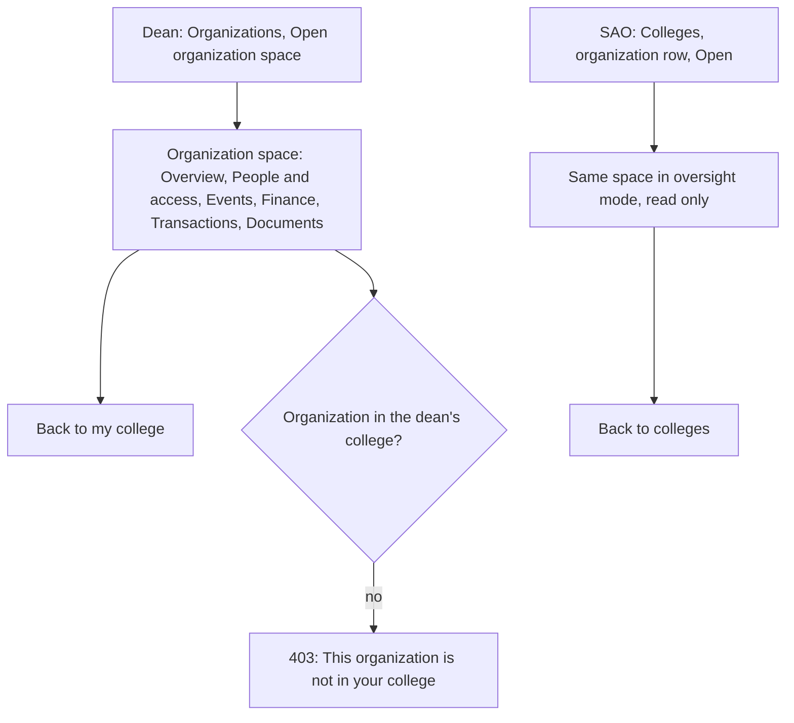

Steps:
1. The dean opens **Organizations** and the row action **Open organization space**. The sidebar switches to the organization space and the banner reads "Viewing <Organization>" with **Back to mine**; the header button **Back to my college** returns to the college.
2. The tabs are **Overview**, **People and access**, **Events**, **Finance**, **Transactions** and **Documents**. **Transactions** is a paginated read only ledger. **Documents** has **Open** on each file and **Open records** to the archive.
3. The SAO opens **Colleges**, expands a college's organizations and uses **Open** on a row. The same page opens in oversight mode with **Back to colleges** and **Registration details**; its people list is read only, because the organization's own Admin gives and removes access.

Outputs: nothing is changed; this is a view. The organization cannot see the dean's or the SAO's part.

The system enforces (`Http/Controllers/OrgSpaceController.php`):
- `GET /college/organizations/{organization}/space` and `.../space/transactions` are `role:DEPARTMENT_HEAD,SUPER_ADMIN`, so an Admin, officer or student gets 403 from the middleware and has no client route to the screen.
- The SAO may open only STUDENT_ORGANIZATION records; a dean only organizations in `scopedOrganizationIds()` (403 "This organization is not in your college.").
- Both endpoints only read; every write route is limited to the organization's own roles.

## 5. Reading the diagrams

The eleven flowcharts above (one hierarchy, one per process) are Mermaid and each one rendered with `@mermaid-js/mermaid-cli` without a parse error. A labelled arrow is the actor's action or a decision outcome; a dashed arrow is an influence, not a step.
